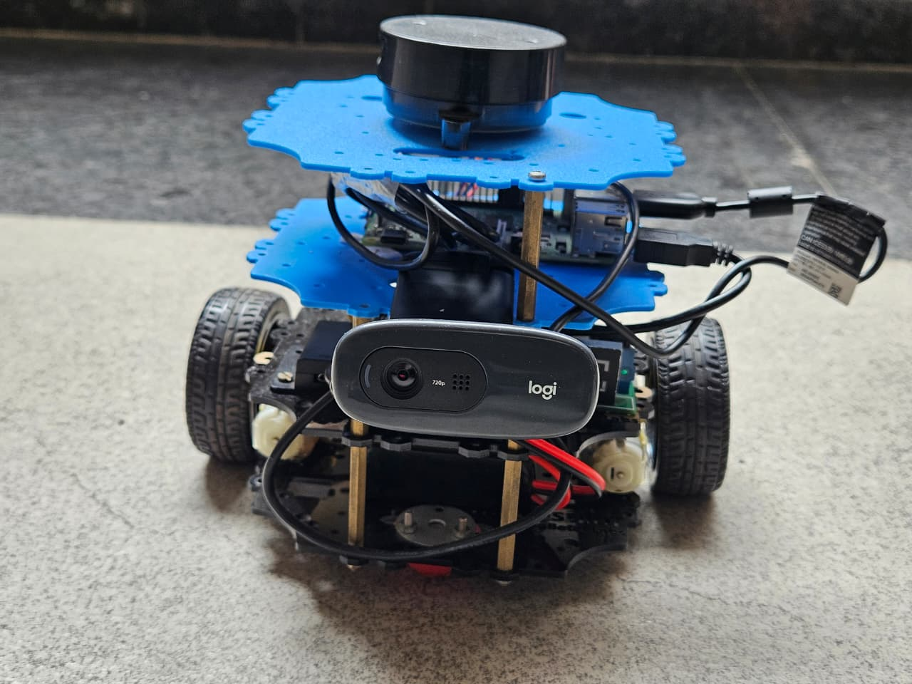
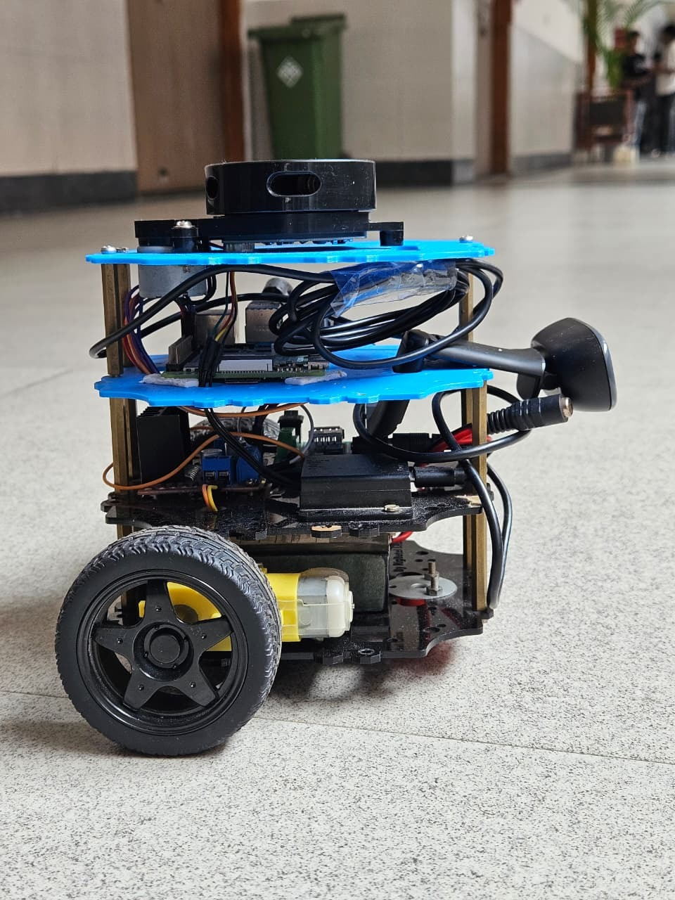
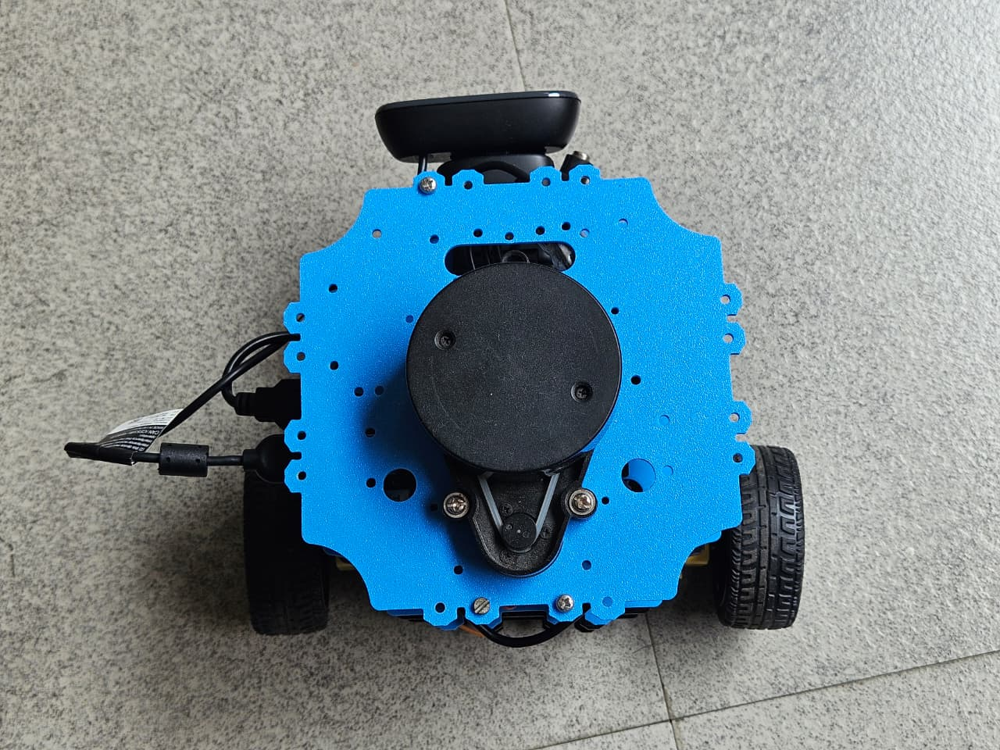
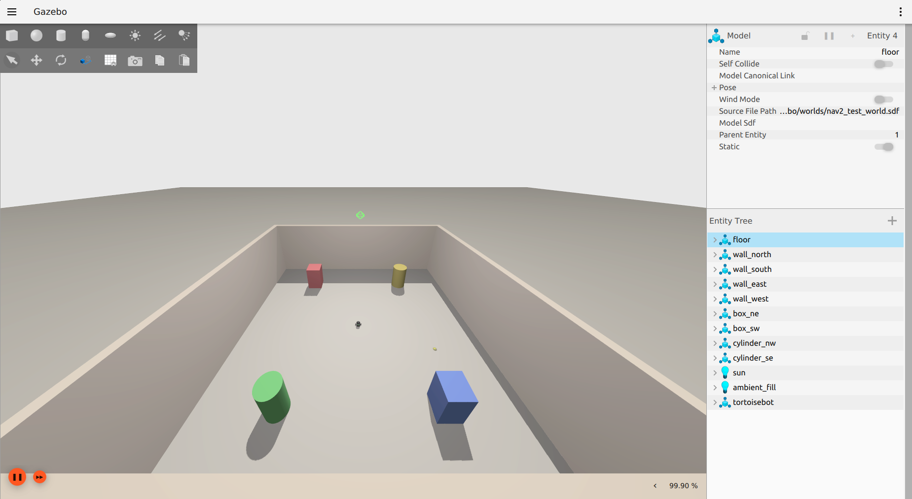
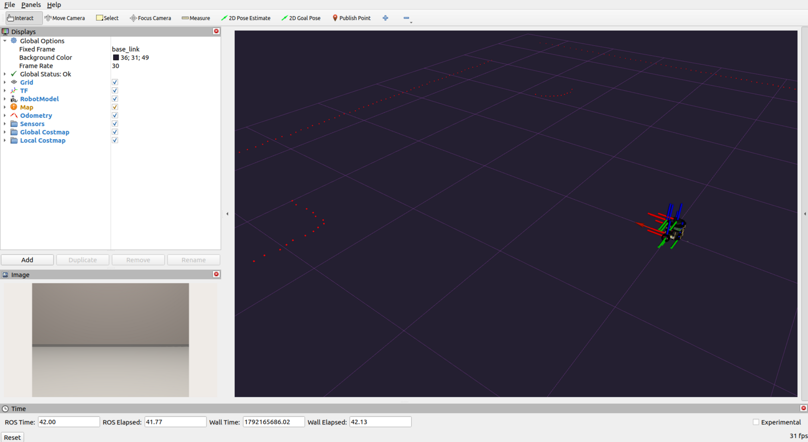
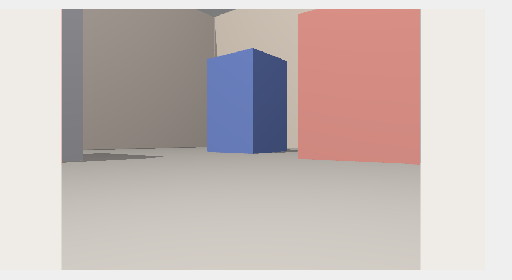
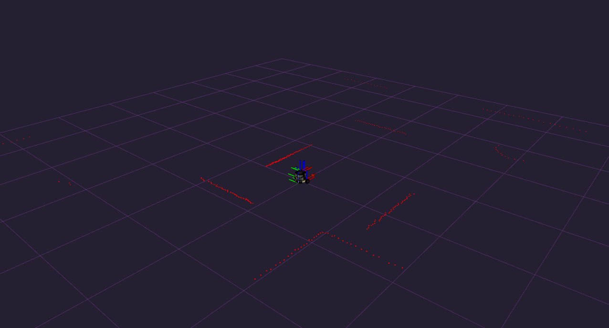

# Vision Pursuit Rover

   

<p align="center">
  
</p>

> An autonomous ROS 2 rover that searches an area, locates a colored target with its camera, pursues it, avoids obstacles using a lidar, and stops when it arrives.

## Contents

- [Overview](#overview)
- [Demo](#demo)
- [How it works](#how-it-works)
- [Key features](#key-features)
- [Toolkit](#toolkit)
- [Simulation](#simulation)
- [Hardware](#hardware)
- [Getting started](#getting-started)
- [Usage](#usage)
- [Code overview](#code-overview)
- [Documentation](#documentation)
- [Conclusion](#conclusion)
- [Limitations and future work](#limitations-and-future-work)
- [Repository structure](#repository-structure)
- [Team](#team)
- [Acknowledgements](#acknowledgements)

## Overview

The Vision Pursuit Rover is a hands-on robotics project. We started with Python and ROS 2 fundamentals in turtlesim, built perception and obstacle avoidance and tested them in Gazebo and RViz2, and then deployed the complete system on a physical rover.

A single ROS 2 node running on a laptop reads the camera and lidar streams from a Raspberry Pi on the rover, decides what the rover should do, and sends back velocity commands.

## Demo

**Full run on the rover:** [watch the demo video](media/videos/robot/final_video.mp4) (opens in GitHub's video player)

| Front | Side | Top |
|:---:|:---:|:---:|
|  |  |  |

All photos, screenshots and videos are indexed in [media/README.md](media/README.md).

## How it works

The rover looks at two things: **can it see the target?** and **is something close in front?**

| State | When | Behavior |
|---|---|---|
| **Search** | No target, path clear | Sweeps the area in a lawnmower pattern of rows and U-turns |
| **Pursue** | Target in view | Steers toward the target and drives at it |
| **Avoid** | No target, obstacle close | Creeps forward while turning toward the side with more free space |
| **Stop** | Target in view, close in front | The target has been reached, so the rover stops moving forward |

The target is found with an OpenCV pipeline: HSV conversion, color segmentation, morphological cleanup, contours, and the target's center. Obstacles are found by splitting the lidar scan into front, left and right sectors. The full design is in [docs/architecture.md](docs/architecture.md), and the vision pipeline is explained in [docs/concepts.md](docs/concepts.md).

## Key features

- Color-based target detection with HSV masking, noise removal and contours
- Lidar obstacle sensing with separate trigger and release distances, which prevents flickering between states
- Lawnmower search pattern that covers the area when no target is visible
- Priority-based state machine, so the target and obstacles are handled in a defined order
- Proportional steering toward the target
- Distributed setup: sensors run on the Raspberry Pi, decision logic runs on a laptop
- Developed in simulation first (Gazebo Ignition and RViz2), then deployed on hardware

## Toolkit

| Category | Tool | Purpose |
|---|---|---|
| Hardware | TortoiseBot kit | Chassis, drive system and electronics |
| Hardware | Raspberry Pi 4 Model B | Onboard computer |
| Hardware | 2D YDLIDAR | Obstacle sensing |
| Hardware | USB webcam | Vision |
| Hardware | 2 BO motors with L298N motor driver | Drive system |
| Hardware | 11.1 V Li-ion battery and power distribution module | Power |
| Software | Ubuntu 22.04 | Operating system |
| Software | ROS 2 Humble | Robot middleware |
| Software | Python 3 | Programming language |
| Software | OpenCV and cv_bridge | Image processing and ROS integration |
| Software | Gazebo Ignition | Physics simulation |
| Software | RViz2 | Visualization of sensor data |
| Software | Git and GitHub | Version control |

The full parts breakdown is in [hardware/parts-list.md](hardware/parts-list.md). Install steps for the software, with links to the official documentation, are in [docs/setup.md](docs/setup.md). What each tool does is explained in [docs/concepts.md](docs/concepts.md).

## Simulation

Before touching the real rover, we developed and tuned the detection and avoidance in Gazebo, with RViz2 showing the sensor data.

| Gazebo simulation | RViz2 |
|:---:|:---:|
|  |  |

| Camera feed | Lidar scan |
|:---:|:---:|
|  |  |

Simulation runs in three worlds of increasing difficulty:
[easy](media/videos/rviz/easy_world.mp4) | [medium](media/videos/rviz/medium_world.mp4) | [hard](media/videos/rviz/hard_world.mp4)

## Hardware

The rover was assembled layer by layer: motors and base, electronics, Raspberry Pi, and sensors. Each part was tested on its own, with the motors, the camera and the lidar checked one at a time, before the full system ran. The build log, the commands used, and the problems we met and fixed are in [docs/hardware-build.md](docs/hardware-build.md).

A motor test program that drives forward, stops, turns left, turns right and stops is in [test/motor_test.py](test/motor_test.py).

## Getting started

**Prerequisites:** Ubuntu 22.04, ROS 2 Humble, and a TortoiseBot or similar rover for the hardware part.

1. Install the tools by following [docs/setup.md](docs/setup.md): ROS 2, Gazebo Ignition, RViz2 and OpenCV.
2. Clone this repository:

```bash
git clone https://github.com/sm21707/vision-pursuit-rover.git
cd vision-pursuit-rover
```

## Usage

The rover and the laptop must be on the same network.

**1. On the Raspberry Pi (over SSH), start the lidar and the drive system:**

```bash
ssh tortoisebot@<ROBOT_IP>
ros2 launch tortoisebot_bringup autobringup.launch.py use_sim_time:=False exploration:=True slam_only:=True
```

**2. In a second SSH terminal, start the camera feed:**

```bash
ros2 run image_tools cam2image --ros-args \
  -p width:=320 -p height:=240 \
  -p frequency:=10.0 \
  -p reliability:=best_effort \
  -p depth:=1
```

**3. On the laptop, confirm the topics are visible, then start the vision pursuit node:**

```bash
source /opt/ros/humble/setup.bash
ros2 topic list
python3 src/04_hardware/vpr_hardware_code.py
```

You should see `/image` and `/scan` in the topic list. A window opens showing the camera view with the detected target outlined. Press **Ctrl+C** to stop, and the node sends a zero velocity so the rover halts.

## Code overview

| Folder | Contents |
|---|---|
| [src/01_python_oops](src/01_python_oops) | Python OOP practice: classes, encapsulation, inheritance, polymorphism |
| [src/02_turtlesim](src/02_turtlesim) | ROS 2 basics in turtlesim: shapes, boundary avoidance, go-to-goal with PID, following, a state machine |
| [src/03_simulation](src/03_simulation) | Color detector and obstacle detector tested in Gazebo and RViz2 |
| [src/04_hardware](src/04_hardware) | The final vision pursuit code that runs on the rover |
| [test](test) | Motor test |

Videos of the turtlesim programs are listed in [media/README.md](media/README.md).

## Documentation

| Document | Contents |
|---|---|
| [Setup](docs/setup.md) | Installing ROS 2, Gazebo, RViz2 and OpenCV, plus learning resources |
| [Concepts](docs/concepts.md) | What ROS 2, Gazebo, RViz2 and OpenCV are and how we used them |
| [Architecture](docs/architecture.md) | The state machine, search pattern, lidar logic and code structure |
| [Hardware build](docs/hardware-build.md) | Assembly, testing and sensor bring-up |
| [Parts list](hardware/parts-list.md) | Components grouped by subsystem |
| [Media](media/README.md) | Index of all photos, screenshots and videos |

## Conclusion

1. **The goal was met, in simulation and on the real rover.** It searches an area, finds a colored target with its camera, pursues it, avoids obstacles using its lidar, and stops on arrival. We tested the logic in Gazebo and RViz2, then ran the same system on hardware.
2. **Reliable behavior came from structure, not just from good sensing.** HSV masking and contours gave a stable target position, and cleaned lidar data gave trustworthy distances. Hysteresis, a fixed turning direction and a clear order between states then turned those readings into steady behavior.
3. **Real hardware needed more debugging than the code did.** Power, cables, camera streaming and the load on the Raspberry Pi all mattered. A robot is a whole system, and its weakest part limits it.

## Limitations and future work

- **The search pattern is open-loop.** Rows and turns are timed, not measured, so wheel slip or a weaker battery makes the pattern drift. Using odometry or an IMU to finish each leg and each 90 degree turn would close the loop.
- **Detection depends on lighting.** The color range is tuned for one environment. Re-tuning it per environment, or adapting it from the image brightness, would make it more robust.
- **Other ideas:** handling red targets (which wrap around the hue range) and estimating the target's distance from its size.

## Repository structure

```
vision-pursuit-rover/
├── README.md
├── LICENSE
├── docs/
│   ├── setup.md              # installation and resources
│   ├── concepts.md           # ROS 2, Gazebo, RViz2 and OpenCV explained
│   ├── architecture.md       # how the final code is built
│   └── hardware-build.md     # assembling and testing the rover
├── hardware/
│   └── parts-list.md
├── media/
│   ├── README.md             # index of all media
│   ├── photos/               # rover photos and simulation screenshots
│   └── videos/               # rover, simulation and turtlesim videos
├── src/
│   ├── 01_python_oops/
│   ├── 02_turtlesim/
│   ├── 03_simulation/
│   └── 04_hardware/          # final code
└── test/
    └── motor_test.py
```

## Team

Built by Shreya, Soham and Pranjal.

## Acknowledgements

This project is built on the **TortoiseBot** by **[RigBetel Labs](https://rigbetellabs.com)**. We are grateful to them for:

- **The platform:** the kit, chassis design and electronics layout.
- **The assembly guide:** we built the rover by following their [Hardware Assembly guide](https://github.com/rigbetellabs/tortoisebot/wiki/2.-Hardware-Assembly).
- **The software stack:** the bring-up package that starts the lidar and drive system, and the lidar driver, come from their [TortoiseBot repository](https://github.com/rigbetellabs/tortoisebot). We did not write them.
- **The documentation and community:** their wiki and community made setup and debugging much easier.

The control, perception and decision-making code in this repository is our own work. We also learned from the tutorials listed in [docs/setup.md](docs/setup.md#8-resources).
