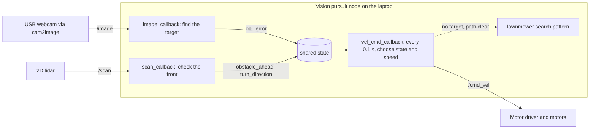
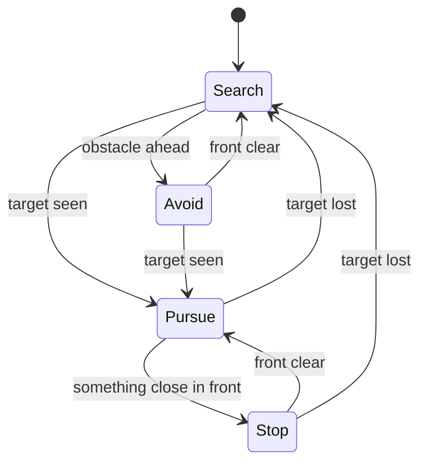
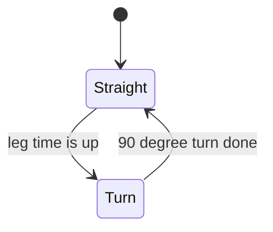

# Architecture

How the final vision pursuit software is built. The code is in [src/04_final_code/vision_pursuit.py](../src/04_final_code/vision_pursuit.py). How the camera image is processed is explained in [concepts.md](concepts.md#4-opencv).

**Contents**
1. [Overview](#1-overview)
2. [Behavior: the state machine](#2-behavior-the-state-machine)
3. [Search: the lawnmower pattern](#3-search-the-lawnmower-pattern)
4. [Lidar: sensing obstacles](#4-lidar-sensing-obstacles)
5. [The code, part by part](#5-the-code-part-by-part)
6. [Settings](#6-settings)
7. [Where it runs](#7-where-it-runs)

## 1. Overview

One ROS 2 node does the whole job, and it runs on a laptop connected to the robot. Two sensor callbacks keep a small shared state up to date, and a timer reads that state ten times a second to decide how the robot moves.



Keeping the decision in one place means the sensors never fight over the motors. The callbacks only report what they see, and the timer is the only thing that publishes velocity commands.

| Topic | Type | Direction | Notes |
|---|---|---|---|
| `/image` | Image | Pi to node | Best-effort delivery, queue depth 1, so only the newest frame is used |
| `/scan` | LaserScan | Pi to node | Best-effort delivery, queue depth 10 |
| `/cmd_vel` | Twist | node to Pi | Forward speed and turn rate |

## 2. Behavior: the state machine

The robot looks at two things: **can it see the target?** and **is something close in front?**

| Target seen | Something in front | State | What the robot does |
|---|---|---|---|
| Yes | No | **Pursue** | Steers toward the target and drives at it |
| Yes | Yes | **Stop** | The thing in front is the target itself, so the robot stops moving forward. It keeps steering to face the target and reports "TARGET REACHED" once centered |
| No | Yes | **Avoid** | Creeps forward slowly while turning away from the obstacle, and resets the search pattern |
| No | No | **Search** | Covers the area with a lawnmower pattern |



An obstacle only triggers avoidance when the target isn't in view. Once the target is in view, whatever is close in front is the target, so the robot stops instead of avoiding it. On shutdown (Ctrl+C), the node publishes a zero velocity so the robot never keeps driving.

## 3. Search: the lawnmower pattern

Without a target in view, the robot sweeps the area in rows, like mowing a lawn, rather than driving in a single line. The pattern alternates between two sub-states, **straight** and **turn**.

| Leg | Sub-state | Duration | What happens |
|---|---|---|---|
| Long row | Straight | 8 s | Drives forward at 0.2 m/s |
| Turn | Turn | about 3.1 s | Rotates 90 degrees at 0.5 rad/s |
| Lane shift | Straight | 4 s | Drives a short distance to the next row |
| Turn | Turn | about 3.1 s | Rotates 90 degrees again, completing a U-turn |



After every second turn the direction flips, so the robot snakes back and forth: row, shift, row in the opposite direction, shift, and so on.

- **Timed turns:** the 90 degree turn is timed, not measured. Its duration is (pi / 2) divided by the turn speed.
- **If the target appears,** pursuit takes over and the leg timer restarts, so the pattern resumes with a full leg if the target is lost.
- **If an obstacle appears,** avoidance takes over, and once the front is clear the pattern starts again with a fresh long row.

## 4. Lidar: sensing obstacles

The lidar scan is split into three sectors by **angle**, not by fixed array positions, so the code still works if the lidar's resolution or scan direction changes.

| Sector | Position | Used for |
|---|---|---|
| Front | +-30 degrees around the front | Detecting an obstacle |
| Left | centered 60 degrees left, +-35 degrees wide | Comparing free space |
| Right | centered 60 degrees right, +-35 degrees wide | Comparing free space |

- **Cleaning the data.** Invalid readings (`nan` or zero) are skipped, and `inf` (nothing detected) is treated as maximum range, so open space can't hide a nearby obstacle.
- **Hysteresis.** Something is detected when the front is closer than 0.4 m, but it is only considered gone once the front is farther than 0.5 m. The gap stops the robot from flipping between states when it is right at the limit.
- **Picking a direction.** When a new obstacle appears, the robot turns toward the side with more free space and keeps that direction until the front is clear. If both sides are nearly equal, it keeps its previous direction. Together these stop the left-right oscillation we saw at walls.

## 5. The code, part by part

| Part | What it does |
|---|---|
| `__init__` | Creates the `/cmd_vel` publisher, subscribes to `/image` and `/scan`, starts the 0.1 s timer, sets every tunable setting, builds the HSV range, and initializes the shared state and the lawnmower variables |
| `get_limits` | Turns the target color into lower and upper HSV bounds |
| `image_callback` | Runs the vision pipeline from [concepts.md](concepts.md#4-opencv), sets `obj_error` (how far the target is from the image center), and draws the detection on the camera view |
| `sector`, `clean` | Helpers: take lidar readings around an index (wrapping around the ends of the array) and remove invalid readings |
| `scan_callback` | Builds the three sectors, finds the closest front reading, and sets `obstacle_ahead` and `turn_direction` |
| `vel_cmd_callback` | Reads the shared state and chooses the state: pursue, stop, avoid or search |
| `lawnmower_cmd`, `set_mow_state`, `mow_elapsed` | Run and time the search pattern |
| `main` | Starts the node, and on shutdown publishes a zero velocity and closes the camera window |

The decision made every 0.1 seconds, in plain form:

```
if the target is visible:
    steer toward it
    if something is close in front:  stop moving forward   (target reached)
    else:                            drive forward
else if something is close in front:
    creep forward while turning away from it
else:
    follow the lawnmower pattern
```

## 6. Settings

| Setting | Value | Meaning |
|---|---|---|
| `kpa` | 0.001 | Steering strength per pixel of error |
| `center_zone` | 2 px | Target counts as centered inside this |
| `pursue_speed` | 0.2 m/s | Speed when chasing |
| `stop_distance` | 0.4 m | Something in front is detected below this |
| `clear_distance` | 0.5 m | Front is clear above this |
| `front_half_angle` | 30 degrees | Half-width of the front sector |
| `avoid_forward_speed` | 0.07 m/s | Slow creep while avoiding |
| `avoid_turn_speed` | 0.6 rad/s | Turn rate while avoiding |
| `mow_speed` | 0.2 m/s | Speed in the lawnmower pattern |
| `mow_turn_speed` | 0.5 rad/s | Turn rate in the lawnmower pattern |
| `long_leg_time` | 8 s | Length of a row |
| `lane_shift_time` | 4 s | Spacing between rows |

The color-detection settings (hue window, saturation and value, kernel size, minimum area) are in [concepts.md](concepts.md#our-settings). All of these values came from trial and error.

## 7. Where it runs

The robot and the laptop talk over Wi-Fi, so both must be on the same network and ROS domain.

- **On the Raspberry Pi (over SSH):** the lidar bring-up and the camera feed.
- **On the laptop:** our vision pursuit node. It subscribes to `/image` and `/scan` from the Pi, shows the camera view with the detected target outlined, and publishes `/cmd_vel` back to the robot.

Because camera frames travel over the network, keeping them small and dropping old ones keeps the robot responsive. The same logic was first tested in Gazebo Ignition and RViz2, then moved to the real robot. See [hardware-build.md](hardware-build.md).
