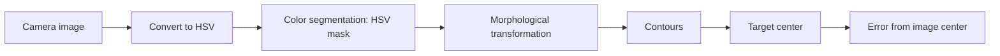

# Concepts and Tools Explained

What each main tool in this project is, why we used it, and how it fits in. The code that uses them is in [src/](../src/).

**Contents**
1. [ROS 2](#1-ros-2)
2. [Gazebo](#2-gazebo)
3. [RViz2](#3-rviz2)
4. [OpenCV](#4-opencv)

## 1. ROS 2

**What it is:** the robot middleware. A robot program is split into small separate programs, and ROS 2 lets them exchange data and run together.

| Concept | Meaning | In our project |
|---|---|---|
| Node | One program with one job | Our vision pursuit node, the camera node, the lidar node |
| Topic | A named channel that carries data | `/image`, `/scan`, `/cmd_vel` |
| Publisher | A node that sends data on a topic | The camera publishes images, our node publishes velocity commands |
| Subscriber | A node that receives data from a topic | Our node subscribes to the camera and lidar |
| Message | The format of the data on a topic | `Image`, `LaserScan`, `Twist` |
| Package | A folder that holds nodes and their settings, built with `colcon` | Our code and the TortoiseBot software |

**Twist.** A Twist message holds a forward speed and a turning speed. It is a velocity, not a distance, so to reach an exact position or angle the robot needs feedback.

**QoS (quality of service).** Topics can be reliable (resend lost data) or best-effort (drop it and move on). For camera and lidar data we use best-effort, because a fresh frame matters more than a lost old one.

**How we learned it:** with turtlesim. We wrote our first node, then a publisher and a subscriber, then made the turtle draw a square, a circle, a polygon and a helical path, avoid the window boundary, go to a goal (with PID), follow another turtle, and finally run a simple state machine. Those programs are in [src/02_turtlesim/](../src/02_turtlesim/).

## 2. Gazebo

**What it is:** a physics simulator. It creates a virtual world with a robot, sensors and obstacles, so software can be tested without touching real hardware.

**Why we used it:** testing in simulation is safe and repeatable. The robot can crash as often as needed and the battery never runs out.

**How we used it:** we learned to build worlds and run a robot inside them, then ran our color detector and obstacle avoider there. We tuned the obstacle distances in simulation before moving to the real robot. The simulation code is in [src/03_simulation/](../src/03_simulation/).

**Simulation versus reality:** some values do not carry over. The color range, the speeds and the distances all needed re-tuning on the real robot.

## 3. RViz2

**What it is:** a visualization tool. Unlike Gazebo it does not simulate anything. It draws the data that ROS topics carry, such as the camera image and the lidar scan, so you can see what the robot sees.

**Gazebo and RViz2 together:** Gazebo is the world the robot lives in, and RViz2 shows what the robot senses and knows about it.

**How we used it:** in simulation, to watch the lidar scan and the camera view. On the real robot, to confirm that the camera feed and the lidar scan were publishing, adjusting RViz2's display settings until each showed up correctly.

## 4. OpenCV

**What it is:** a computer vision library. We use it to find the colored target in each camera image. `cv_bridge` converts ROS image messages into OpenCV images.

Our pipeline, in the order the image passes through it:



### Step 1: Convert the image to HSV

As soon as an image of the environment arrives, we convert it from BGR to HSV. The same color can look very different under different lighting or in shadow. In BGR, those changes alter the values of every channel, so pixels of the same object can end up with drastically different numbers. In HSV the hue stays almost the same, and mostly the saturation and value change, so one hue range can find the target across varying lighting.

```python
frame = self.bridge.imgmsg_to_cv2(msg, desired_encoding='bgr8')
hsv = cv2.cvtColor(frame, cv2.COLOR_BGR2HSV)
```

### Step 2: Color segmentation

We apply an HSV mask so the robot focuses only on the target color and ignores everything else. Every pixel inside our defined range becomes 255 (white) and every pixel outside becomes 0 (black), giving a binary image.

```python
mask = cv2.inRange(hsv, self.lower_hsv, self.upper_hsv)
```

The range is built around the hue of the target color, with a minimum saturation and value that ignores washed-out and very dark pixels.

### Step 3: Morphological transformations

The binary image still contains noise, such as stray white pixels. Before looking for contours we clean it with morphological opening (erosion followed by dilation).

```python
mask = cv2.morphologyEx(mask, cv2.MORPH_OPEN, self.kernel)
```

We use this instead of simply blurring because blurring only smooths over the image, which softens the noise and makes the edges fuzzy. Opening removes the small specks and leaves the target region clean and well defined.

### Step 4: Contours

Contours identify the shape of the object and separate it from the background. If several regions are found, we take the one with the largest area, and we ignore anything under a minimum size so noise can't be mistaken for the target.

```python
contours, _ = cv2.findContours(mask, cv2.RETR_EXTERNAL, cv2.CHAIN_APPROX_SIMPLE)
biggest = max(contours, key=cv2.contourArea, default=None)
```

### Step 5: Target center

From the contour we take a single point for the target: the center of its bounding box. It is far easier for the robot to follow one coordinate than a whole body.

```python
x, y, w, h = cv2.boundingRect(biggest)
center_x = x + w // 2
```

`boundingRect` returns the smallest upright rectangle around the contour: its top-left corner (`x`, `y`) and its width and height (`w`, `h`). The middle of that rectangle is the target's position.

### From target center to steering

The horizontal distance between the target's center and the middle of the image is the error that drives the robot. Negative means the target is to the left, positive means to the right.

```python
obj_error = center_x - width // 2
```

If nothing big enough is found, the error is set to `None`, which tells the state machine that the target is not in view. For debugging, we draw a rectangle and a dot on the detected target and show the frame with `cv2.imshow`, which made wrong detections obvious and was the fastest way to tune the color range.

### Our settings

| Setting | Value | Purpose |
|---|---|---|
| Target color | green | The color the robot pursues |
| Hue window | target hue +-20 | Range of colors accepted |
| Minimum saturation and value | 40 | Rejects washed-out and dark pixels |
| Morphology kernel | 5x5 | Size of the noise-removal window |
| Minimum target area | 150 px | Smaller blobs are ignored as noise |

**Notes from tuning:** the HSV range has to be tuned with the real camera and real lighting, because values that work in simulation rarely carry over unchanged. Lowering the camera to 320x240 at 10 frames per second keeps the Raspberry Pi responsive.

The final code is in [src/04_hardware/vpr_hardware_code.py](../src/04_hardware/vpr_hardware_code.py), and the earlier simulation version is in [src/03_simulation/color_detector.py](../src/03_simulation/color_detector.py).
